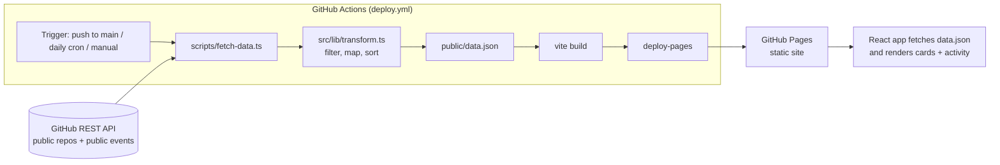

# github-portfolio

[](https://github.com/ottonielmorais2008-rgb/github-portfolio/actions/workflows/ci.yml)
[](https://github.com/ottonielmorais2008-rgb/github-portfolio/actions/workflows/deploy.yml)

A portfolio page that **updates itself** from my public GitHub repositories and activity. No manual edits: when I push a new project, set a description, a homepage or topics, the page picks it up on the next build.

**Live:** https://ottonielmorais2008-rgb.github.io/github-portfolio/

## What the page shows

- A short header with my name and focus: networking, AI and crypto.
- One card per public project: name, description, topics, language, stars, last update, a **Live demo** button (only when the repo has a homepage set) and a **Code** button.
- A language filter (All / TypeScript / Shell / …).
- A **Recent activity** list built from my public GitHub events: latest pushes (with the commit message), pull requests, releases and new repos.
- A **Last updated** timestamp, so you can see when the data was fetched.

What is left out on purpose: forks, archived repos, the profile README repo and anything private. Homepages pointing at `localhost` or private IPs are ignored.

## How auto-update works

The site is static. All data is fetched **at build time** by `scripts/fetch-data.ts` and written to `public/data.json`, which the page loads.

The `deploy.yml` workflow rebuilds and redeploys to GitHub Pages:

- on every push to `main`,
- **every day at 06:00 UTC** (cron schedule),
- and on demand (`workflow_dispatch`).

Each run regenerates `data.json`, so the page stays current without anyone touching it. The workflow's built-in `GITHUB_TOKEN` is only used to raise the API rate limit; the script calls the public endpoints (`/users/{user}/repos` and `/users/{user}/events/public`), which never return private data.



## Tech stack

- **React 19 + TypeScript**, built with **Vite**
- **GitHub REST API** (public endpoints only)
- **Vitest** for unit tests
- **GitHub Actions** for CI and scheduled deploys
- **GitHub Pages** for hosting

## Project structure

```
scripts/fetch-data.ts     build-time fetch -> public/data.json
src/lib/transform.ts      pure logic: filtering, mapping, sorting, activity summaries
src/lib/transform.test.ts unit tests for that logic
src/App.tsx               the page
.github/workflows/        ci.yml (test + build), deploy.yml (Pages, daily)
```

## Tests

The data-transform logic is pure and fully unit-tested (repo filtering, homepage safety checks, mapping, sorting, activity summaries, language filter):

```bash
npm test
```

CI runs install, tests, a real data fetch and the production build on every pull request and push to `main`.

## Run locally

```bash
npm install
npm run fetch-data   # writes public/data.json (set GITHUB_TOKEN to avoid rate limits)
npm run dev          # opens on http://localhost:5173/github-portfolio/
```

To use it for another account, set `GITHUB_USERNAME` before `npm run fetch-data`.

## What went wrong (and how I fixed it)

- **Push events had no commit messages.** The first version of the activity list only said "Pushed to main" for every push. The public events API no longer includes the `commits` array in `PushEvent` payloads, and `PullRequestEvent` payloads come without the PR title. Fix: for the few events actually shown, the fetch script looks up the head commit (`/repos/{repo}/commits/{sha}`) and the PR (`/repos/{repo}/pulls/{n}`). If a lookup fails, the entry falls back to a shorter summary instead of breaking the build.
- **Duplicate entries after merging a PR.** Merging a PR produced two entries: "Merged pull request #1" and a push of "Merge pull request #1 from …". The merge-commit push is now skipped, and new-branch events are dropped as noise.
- **TypeScript rejected the `.ts` import** in the Node script (`TS5097`) and the `test` key in `vite.config.ts`. Fixed by using an extensionless import (run through `tsx`) and adding the `vitest/config` type reference.

## License

[MIT](LICENSE) © Ottoniel Morais
